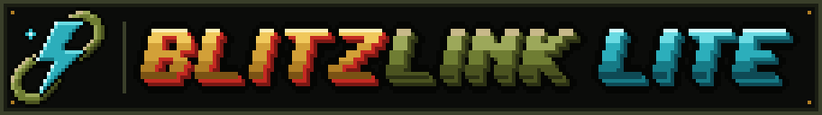
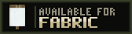
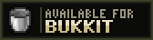

<p align="center"></p>
<p align="center">
  
  
  
</p>

# BlitzLink Lite (26.3)

[English](README.md)

**BlitzLink Lite는 [BlitzLink](https://github.com/HY-Project/BlitzLinkMC)에서 네이티브 실행 파일을 뺀 판이다.** 네이티브
BlitzLink는 Rust 사이드카(`blitzlink-tunnel.exe` 등)를 jar에 담아 따로 프로세스로 띄우는데, CurseForge처럼 실행 파일이 든 파일을
받지 않는 모드 사이트가 있다. Lite는 같은 일을 게임 안에서 한다. 터널은 순수 Java이고, WebRTC는
[webrtc-java](https://github.com/devopvoid/webrtc-java)(구글 libwebrtc의 JNI 판)가 맡는다.

> **쓸 수 있다면 네이티브 BlitzLink를 쓰자: [github.com/HY-Project/BlitzLinkMC](https://github.com/HY-Project/BlitzLinkMC).**
> jar가 세 배 작고, 네트워크 처리를 게임 프로세스 밖에서 하며, UDP 포트 하나만 고정해서 쓴다.
> Lite는 네이티브 판을 올릴 수 없는 곳을 위한 것이다.

나머지는 모두 BlitzLink 그대로다. `MCJE-XXXX` 참가 코드, 같은 중계(hyproj.com은 WebRTC Offer/Answer와 공개 목록만 건네고 게임 데이터는
P2P로 오간다), 참가 전 모드 목록 비교, 플레이어 실제 IP, NeoForge·Fabric 공용 jar 하나, 버킷 계열 플러그인.

## Lite와 네이티브는 같이 논다

Lite는 네이티브 BlitzLink의 프로토콜을 바이트 단위로 똑같이 쓴다. 중계 메시지, `meta`/`mc-N` DataChannel, 서버 신원 증명, 내장 TURN이
모두 같다. Lite 클라이언트가 네이티브 서버에 들어가고 그 반대도 된다. 직접 UDP로도, TURN으로도.
`tunnel/src/test/java/com/hyproj/blitzlink/lite/InteropTest.java`가 실제 네이티브 중계·사이드카를 상대로 네 가지 조합을 CI마다 확인한다.

두 판 모두 모드 id가 `blitzlink`라서 **둘 중 하나만** 설치한다. `config/blitzlink/`를 같이 쓰므로 서버가 판을 바꿔도 호스트 키·지문·참가
코드가 그대로다.

## 네이티브와 비교

| | 네이티브 BlitzLink | BlitzLink Lite |
|---|---|---|
| 터널 | Rust 사이드카 프로세스(str0m), stdin/stdout으로 제어 | 게임 JVM 안의 Java, JNI로 libwebrtc |
| jar 속 실행 파일 | 4개(`blitzlink-tunnel`, Windows/Linux × x64/arm64) | **없음** |
| 모드 jar 크기 | 약 17 MB | **약 55 MB**(여섯 플랫폼의 libwebrtc) |
| 게임 프로세스 | 그대로. 메모리·CPU는 사이드카 몫 | **libwebrtc(네이티브 코드 17–26 MB)가 게임에 올라오고**, 패킷마다 JNI와 JVM 힙을 거쳐 복사된다(바쁜 서버에서 GC 부담이 는다) |
| 네트워크 코드가 죽으면 | 사이드카만 끝나고 게임은 계속 | **게임·서버가 같이 죽을 수 있다** |
| 첫 실행 | 약 10 MB 사이드카를 푼다 | 17–26 MB 라이브러리를 `config/blitzlink/natives/`에 푼다 |
| 호스트 UDP 포트 | 게임 포트 번호의 소켓 하나, `upnp`가 그 포트를 연다 | **연결마다 새 임의 UDP 포트**: UDP 포트포워딩은 소용없고 `upnp`는 TCP만 연다(홀펀칭·TCP TURN은 그대로 된다) |
| 상태의 `udpPort` | 공용 소켓 포트 | 가장 최근 연결의 포트 |
| 플랫폼 | Windows, Linux (x64, arm64) | Windows, Linux, **macOS** (x64, arm64) |
| 화면 없는 Linux 서버 | 따로 할 것 없음 | 된다. libwebrtc가 링크한 X11·GLib·GBM 자리를 대역으로 채운다(`HeadlessLinux`) |

처리량. Windows 11 노트북 한 대에서 루프백으로 잰 값이다(64 MB를 호스트 → 참가자로 메아리, `BenchTest`). CPU 비용만 보는 숫자이고,
인터넷에서는 터널이 아니라 회선이 한계다.

| 호스트 → 참가자 | 직접 UDP | TURN(TCP) |
|---|---|---|
| 네이티브 → 네이티브 | 5.9 MB/s | 34 MB에서 끊김 |
| Lite → Lite | 11.9 MB/s | 8.1 MB/s |
| 네이티브 호스트 → Lite 참가 | 20.3 MB/s | 11.0 MB/s |
| Lite 호스트 → 네이티브 참가 | 10.5 MB/s | 5 MB에서 끊김 |

즉 순수 처리량은 줄지 않는다. 여기서는 libwebrtc의 SCTP가 str0m보다 빠르다. Lite의 비용은 위 표의 것들이다. 게임 프로세스 안에서
쓰는 메모리와 CPU, 더 큰 다운로드, 충돌 격리가 없다는 점, 고정 UDP 포트가 없다는 점.
(끊긴 두 경우는 모두 TURN을 쓰는 네이티브 참가자다. Lite가 아니라 네이티브 BlitzLink의 TURN 클라이언트 쪽 문제다.)

## 스크린샷

화면은 네이티브 BlitzLink와 같다.

<p align="center"></p>
<p align="center">
  
  
</p>

## 구성

| 경로 | 내용 |
|---|---|
| `tunnel/` | **Lite 터널**(`com.hyproj.blitzlink.lite`): 중계 연결, 호스트·참가 세션, 내장 TURN 서버, UPnP, STUN, 신원, TCP ↔ DataChannel 파이프. 마인크래프트 클래스는 쓰지 않는다 |
| `common/` | 로더와 무관한 Java(바닐라로 컴파일): UI, 터널 제어, 모드 비교, mixin(네이티브와 같음) |
| `neoforge/`, `fabric/` | 로더별 진입점과 모드 목록 수집 |
| `bukkit/` | Spigot/Paper 플러그인(호스트 전용) |
| `data/net.json` | 중계 주소와 STUN(네이티브 BlitzLink와 같은 파일) |
| `docs/ko/`, `docs/en/` | `SERVER_GUIDE.md`, `RELAY.md`, `PROTOCOL.md`(프로토콜은 네이티브 것), 스토어 문서 |
| `branding/` | `gen_lite_logo.py`(아이콘·배너), 로더 배지, `modrinth/` 손그림 아이콘 |

## 빌드

```
./gradlew build
```

모두 빌드하고 시험한다.

- `build/libs/blitzlink-lite-<버전>+mc26.3.jar`: NeoForge·Fabric 공용 모드 파일 하나. GitHub 릴리스와 CurseForge용.
- `build/libs/BlitzLink-Lite-HAE-<버전>+mc26.3.jar`(태스크 `haeJar`): **BlitzLink Lite HAE (Human Art Edition)**. 내용은 같고
  모드 아이콘만 `branding/modrinth/`의 손그림이다. AI 그림을 금지하는 Modrinth용.
- `bukkit/build/libs/blitzlink-lite-bukkit-26.3-<버전>.jar`: 버킷 계열 플러그인.

webrtc-java와 Windows·Linux·macOS(x64, arm64)용 libwebrtc는 Maven Central에서 받아 손대지 않고 각 jar에 넣는다.

시험: `CodecTest`(와이어 형식), `TunnelE2eTest`(Lite 호스트 ↔ Lite 참가, 실제 WebRTC로 직접·TURN 둘 다, 작은 Java 시험 중계를 거쳐).
네이티브 BlitzLink 바이너리가 있으면(그 저장소 `native/`에서 `cargo build --release -p blitzlink-relay -p blitzlink-tunnel`):

```
./gradlew :tunnel:test --tests '*InteropTest' -Pblitzlink.native.dir=<네이티브>/native/target/release
./gradlew :tunnel:test --tests '*BenchTest' -Pbench -Pblitzlink.native.dir=<네이티브>/native/target/release
```

CI(`.github/workflows/build.yml`, 브랜치 `mc-*`)는 데스크톱 라이브러리가 없는 맨 JDK 컨테이너(Linux x64·arm64), Windows x64·arm64,
macOS에서 터널 시험을 돌리고, 소스에서 빌드한 네이티브 BlitzLink와 상호 운용 시험도 돌린다.

## 개발 실행

```
./gradlew :neoforge:runClient -Pblitzlink.relay=http://127.0.0.1:1947 -Pblitzlink.stun=stun:127.0.0.1:3478
./gradlew :neoforge:runServer -Pblitzlink.relay=http://127.0.0.1:1947
./gradlew :neoforge:runClientJar      # 플레이어가 받는 그대로의 공용 jar
```

## 브랜치와 버전

네이티브 BlitzLink와 같다. 버전은 마인크래프트를 따르고(26.3이면 `26.3.x`, 태그 `v26.3.0`), 마인크래프트 버전마다 브랜치 하나
(`mc-26.3`, …), 기본 브랜치는 항상 최신 안정판이다.

## 라이선스

Apache License 2.0 — [LICENSE](LICENSE), [NOTICE](NOTICE). 동봉한 글꼴(Black Ops One, Noto Sans KR, Courier Prime)은 SIL Open Font
License 1.1을 따른다([docs/license/](docs/license/)). webrtc-java는 Apache-2.0, libwebrtc는 BSD-3-Clause이며 그 라이선스는 jar의
`META-INF/licenses/webrtc-java/`에 들어 있다.
