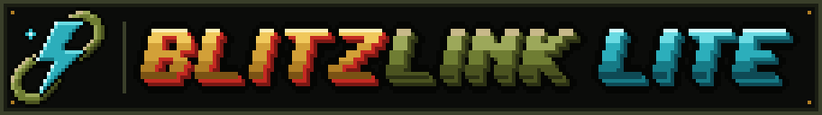
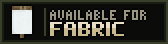
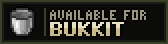

<p align="center"></p>
<p align="center">
  
  
  
</p>

# BlitzLink Lite (26.3)

[한국어](README.ko.md)

**BlitzLink Lite is [BlitzLink](https://github.com/HY-Project/BlitzLinkMC) without its native executable.** Native BlitzLink
carries a Rust sidecar (`blitzlink-tunnel.exe` and friends) and starts it as a separate process; some mod sites, CurseForge
among them, reject files that contain executables. Lite does the same job inside the game: its tunnel is plain Java, and
WebRTC comes from [webrtc-java](https://github.com/devopvoid/webrtc-java) (Google's libwebrtc as a JNI library).

> **Use native BlitzLink if you can: [github.com/HY-Project/BlitzLinkMC](https://github.com/HY-Project/BlitzLinkMC).**
> It is three times smaller, keeps networking out of the game process and opens one fixed UDP port.
> Lite is for places where the native edition can't be published.

Everything else is BlitzLink: `MCJE-XXXX` join codes, the same relay (hyproj.com only passes WebRTC offers/answers and the
public list; game data flows peer-to-peer), the mod-list check before joining, real player IPs, NeoForge + Fabric in one jar and a
Bukkit-family plugin.

## Lite and native play together

Lite speaks native BlitzLink's protocol byte for byte: the same relay messages, the same `meta`/`mc-N` DataChannels, the same
server identity proof and the same embedded TURN. A Lite client joins a native server and the other way round, over direct UDP
or over TURN. `tunnel/src/test/java/com/hyproj/blitzlink/lite/InteropTest.java` checks all four pairings against the real
native relay and sidecar on every CI run.

Both editions use the mod id `blitzlink`, so install **one or the other**, never both. They share `config/blitzlink/`, so a server
that switches editions keeps its host key, fingerprint and join code.

## Lite compared with native

| | Native BlitzLink | BlitzLink Lite |
|---|---|---|
| Tunnel | Rust sidecar process (str0m), driven over stdin/stdout | Java in the game's JVM, libwebrtc over JNI |
| Executables in the jar | 4 (`blitzlink-tunnel`, Windows/Linux × x64/arm64) | **none** |
| Mod jar size | ~17 MB | **~55 MB** (libwebrtc for six platforms) |
| Game process | untouched; the sidecar's memory and CPU are its own | **libwebrtc (17–26 MB of native code) loads into the game**, and every packet is copied across JNI and through the JVM heap (more garbage to collect on a busy server) |
| A crash in the networking code | ends the sidecar, the game keeps running | **can take the game or server down with it** |
| First start | unpacks a ~10 MB sidecar | unpacks a 17–26 MB library into `config/blitzlink/natives/` |
| Host UDP port | one socket on the game's port number; `upnp` maps it | **a new random UDP port per connection**: forwarding a UDP port does nothing, and `upnp` maps TCP only (hole punching and TCP TURN still work) |
| Status `udpPort` | the shared socket's port | the newest connection's port |
| Platforms | Windows, Linux (x64, arm64) | Windows, Linux **and macOS** (x64, arm64) |
| Headless Linux servers | nothing needed | works, using stand-ins for the X11/GLib/GBM libraries libwebrtc links against (`HeadlessLinux`) |

Throughput, measured on one Windows 11 laptop over loopback (64 MB echoed through host → join, two runs each; `BenchTest`,
native BlitzLink 26.3.1). This is CPU cost only: over the internet your connection is the limit, not the tunnel.

| Host → join | Direct UDP | TURN (TCP) |
|---|---|---|
| native → native | 5.0–9.7 MB/s | 4.3–4.7 MB/s |
| Lite → Lite | 12.8–13.8 MB/s | 8.7–8.8 MB/s |
| native host → Lite join | 15.9–20.1 MB/s | 9.9–13.6 MB/s |
| Lite host → native join | 6.0–12.5 MB/s | 5.5–6.0 MB/s |

So Lite does not lose raw throughput: libwebrtc's SCTP outruns str0m here. Its costs are the ones in the table above: memory
and CPU inside the game process, the bigger download, no isolation from crashes, and no fixed UDP port.

Native BlitzLink 26.3.1 or newer is recommended next to Lite: older native hosts were dropped by the relay every 75 s when their
player count did not change (Lite hosts never were).

## Screenshots

The UI is the same as native BlitzLink's.

<p align="center"></p>
<p align="center">
  
  
</p>

## Layout

| Path | What |
|---|---|
| `tunnel/` | **The Lite tunnel** (`com.hyproj.blitzlink.lite`): relay link, host/join sessions, embedded TURN server, UPnP, STUN, identity, TCP ↔ DataChannel pipes. No Minecraft classes |
| `common/` | Loader-independent Java (compiled against vanilla): UI, tunnel control, mod comparison, mixins (shared with native) |
| `neoforge/`, `fabric/` | Loader entrypoints and mod-list collection |
| `bukkit/` | Spigot/Paper plugin (host only) |
| `data/net.json` | Relay URL and STUN servers (the same file native BlitzLink uses) |
| `docs/en/`, `docs/ko/` | `SERVER_GUIDE.md`, `RELAY.md`, `PROTOCOL.md` (the protocol is native's), store pages |
| `branding/` | `gen_lite_logo.py` (icon and banner), loader badges, `modrinth/` hand-drawn icon |

## Build

```
./gradlew build
```

This builds and tests everything:

- `build/libs/blitzlink-lite-<version>+mc26.3.jar`: one mod file for NeoForge and Fabric, for GitHub releases and CurseForge.
- `build/libs/BlitzLink-Lite-HAE-<version>+mc26.3.jar` (task `haeJar`): **BlitzLink Lite HAE (Human Art Edition)**. The same
  jar with the hand-drawn icon from `branding/modrinth/`, for Modrinth, which does not allow AI-generated art.
- `bukkit/build/libs/blitzlink-lite-bukkit-26.3-<version>.jar`: the Bukkit-family plugin.

webrtc-java and libwebrtc for Windows/Linux/macOS (x64, arm64) come from Maven Central and go into each jar unchanged.

Tests: `CodecTest` (wire formats), `TunnelE2eTest` (Lite host ↔ Lite join over real WebRTC, direct and TURN, through a small Java
test relay). With native BlitzLink's binaries (`cargo build --release -p blitzlink-relay -p blitzlink-tunnel` in its `native/`):

```
./gradlew :tunnel:test --tests '*InteropTest' -Pblitzlink.native.dir=<native>/native/target/release
./gradlew :tunnel:test --tests '*BenchTest' -Pbench -Pblitzlink.native.dir=<native>/native/target/release
```

CI (`.github/workflows/build.yml`, branches `mc-*`) also runs the tunnel tests in a bare JDK container on Linux x64 and arm64
(no desktop libraries), on Windows x64/arm64 and macOS, and the interop tests against native BlitzLink built from source.

## Dev runs

```
./gradlew :neoforge:runClient -Pblitzlink.relay=http://127.0.0.1:1947 -Pblitzlink.stun=stun:127.0.0.1:3478
./gradlew :neoforge:runServer -Pblitzlink.relay=http://127.0.0.1:1947
./gradlew :neoforge:runClientJar      # the universal jar exactly as players get it
```

## Branches and versions

As in native BlitzLink: versions follow Minecraft (`26.3.x` for 26.3, tags `v26.3.0`), one branch per Minecraft version
(`mc-26.3`, …) and the default branch is the latest stable one.

## License

Apache License 2.0, see [LICENSE](LICENSE) and [NOTICE](NOTICE). Bundled fonts (Black Ops One, Noto Sans KR, Courier Prime) are
under the SIL Open Font License 1.1 ([docs/license/](docs/license/)). webrtc-java is Apache-2.0 and libwebrtc is BSD-3-Clause; their
licences ship in the jar under `META-INF/licenses/webrtc-java/`.
