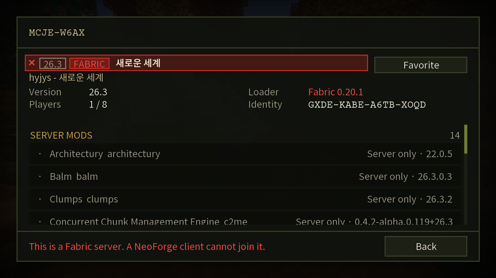
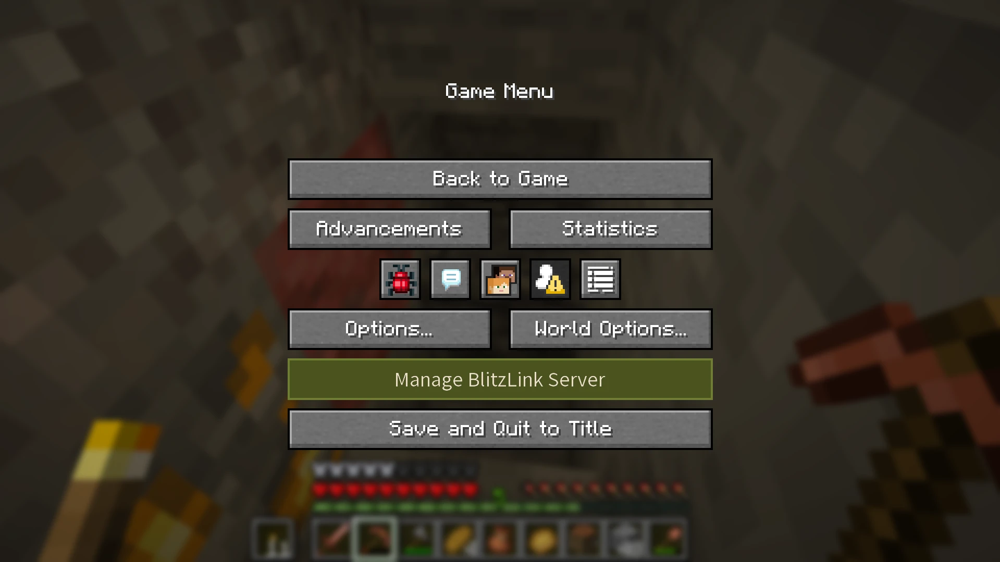
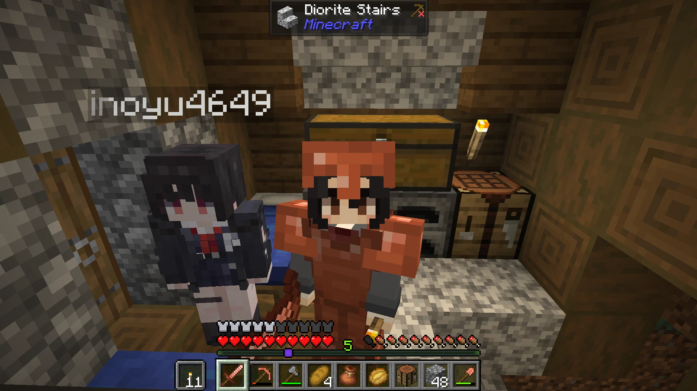

🎨 **Modrinth Exclusive: Human Art Edition** — Featuring 100% hand-drawn Programmer Art!

**BlitzLink Lite** is [BlitzLink](https://github.com/HY-Project/BlitzLinkMC) without the executable (the Rust sidecar): its tunnel runs inside the game in Java (webrtc-java). **Lite and native BlitzLink join each other freely.** Where you can, prefer [native BlitzLink](https://github.com/HY-Project/BlitzLinkMC): it is lighter and faster.

**Join any server with one code. No IP addresses, and usually no port forwarding.**

Open your world or start your server, share a code like `MCJE-W6AX`, and friends join from the multiplayer screen. The relay only
introduces the two sides; your game traffic goes **directly** between players and the server over an encrypted peer-to-peer
connection (WebRTC).

One jar for **NeoForge** and **Fabric**, plus a **Bukkit plugin** for Spigot / Paper servers.

---

## Join with a code

The Multiplayer button opens BlitzLink, with three tabs:
- **Relay**: type a join code, or pick a server from the public list.
- **Vanilla Multiplayer**: the usual server list, unchanged.
- **Open Server**: host a world for friends.

Every public server shows its game version and loader. One your client cannot join is marked red with ✕ before you click it.

## Check the server before you join

Pick a server or enter a code and BlitzLink fetches the server's mod list **directly from the server**, then compares it with yours:
- ✓ installed with the same version
- ✕ on red, **Install**: you are missing a required mod
- ✕ on red, **Version differs**: shows the server's version next to yours
- *Server only*: nothing to install

Missing mods block **Join** until you install them; **Join anyway** is still there behind a warning.

If the game version or the loader (NeoForge / Fabric) does not match, the whole card turns red and says why.

## Open your world in one click

- Pick a singleplayer world on **Open Server** and it opens straight away with a join code.
- In game, **Open BlitzLink Server** sits in the pause menu where "Open to LAN" used to be. Once the world is open, the same button
  becomes **Manage BlitzLink Server**.
- **Import Server ZIP**: drop a zipped server folder or world on the window to play it as a hosted world.
- **Dedicated servers print a code on start.** NeoForge and Fabric servers show `BlitzLink: join code MCJE-…` in the console. The
  code stays the same across restarts.

## Then just play

**Works through most home networks**
- UDP hole punching connects most home connections without any setup.
- Optional UPnP opens the port on your router for you.
- If UDP is blocked (school or office networks), BlitzLink falls back to a TURN relay built into the host, over TCP.
  Traffic still goes only to that host.

**Real player IPs.** Players who join through BlitzLink appear with their real address in server logs and bans, not as `127.0.0.1`.

**Bukkit plugin.** Spigot, Paper, Purpur and other Bukkit-based servers can host too. NeoForge and Fabric players with BlitzLink join
by code, and the plugin list shows on the server card. The server still accepts normal connections by address.

**Bring your own relay.** In **BlitzLink → Settings** you can point the mod at any self-hosted `blitzlink-relay`.

---

## Requirements

- Minecraft **26.3**
- **NeoForge** 26.3.0.103 or newer, **or** **Fabric** Loader 0.20.1+ with **Fabric API**. One jar works for both loaders.
- Windows, Linux or macOS (x64, ARM64). Headless Linux servers work too.
- To host on a Bukkit-family server, use the separate **BlitzLink plugin** for Spigot / Paper 26.3.

BlitzLink is needed **on the client to join by code**, and **on the server to host one**. Hosting from singleplayer needs nothing
else.

## Commands (server operators)

- `/blitzlink code`: show the join code
- `/blitzlink public on|off`: show or hide the server in the public list
- `/blitzlink regen`: request a new code

Settings: `config/blitzlink/config.json` (mod) or `plugins/BlitzLink/config.yml` (plugin).

---

## How it works, and what it sends

- BlitzLink ships a small native helper, `blitzlink-tunnel`, written in Rust. It is **bundled inside the jar** (not downloaded) and
  unpacked into `.blitzlink/bin/` on first use. It handles the peer-to-peer connection.
- **The relay** sees the join code, the server's public key fingerprint, the summary shown in the public list (name, MOTD, versions,
  player count) and connection IP addresses. It never sees chat, world data or anything you do in game.
- **Your mod list** is sent from the server to joining players over the direct connection, never through the relay.
- **Identity check:** every server has its own key. Your client verifies it on every join and warns you if it does not match what the
  relay reported.

---

## About this edition

**BlitzLink-HAE (Human Art Edition)**, the Modrinth jar, has the same code as the GitHub and CurseForge releases. The only difference is the mod icon, drawn by hand
with a mouse in Piskel. Every image on this page is an in-game screenshot.

## Open source

BlitzLink is open source under the **Apache License 2.0**.
Source, issues and self-hosting docs: https://github.com/HY-Project/BlitzLinkMC

Made by **HY Project**. Bundled fonts are licensed under the SIL Open Font License 1.1.
