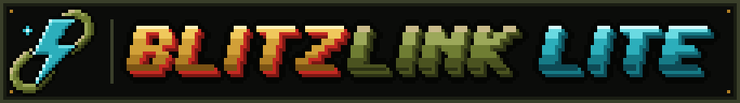
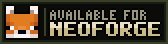
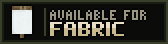
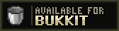
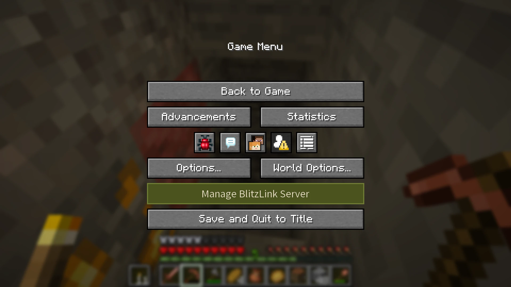
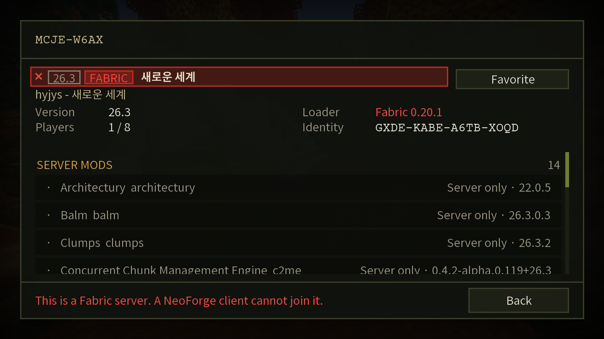

  

**BlitzLink Lite**는 [BlitzLink](https://github.com/HY-Project/BlitzLinkMC)에서 실행 파일(Rust 사이드카)을 뺀 판이다. 터널을 Java(webrtc-java)로 게임 안에서 돌린다. **네이티브 BlitzLink와 서로 들어갈 수 있다.** 쓸 수 있다면 더 가볍고 빠른 [네이티브 BlitzLink](https://github.com/HY-Project/BlitzLinkMC)를 권한다.

**코드 하나로 서버에 들어간다. IP 주소도, 대개는 포트포워딩도 필요 없다.**

월드를 열거나 서버를 켜고 `MCJE-7K3Q` 같은 코드를 친구에게 알려 주면, 친구는 멀티플레이 화면에서 바로 들어온다. 중계 서버는 양쪽을
소개만 하고, 게임 데이터는 플레이어와 서버가 암호화된 P2P 연결(WebRTC)로 **직접** 주고받는다.

---

## 기능

**새 멀티플레이 화면** — 「멀티플레이」를 누르면 BlitzLink 화면이 뜬다.
- **중계 참가** — 참가 코드를 적거나 공개 서버 목록에서 고른다.
- **바닐라 멀티플레이** — 원래 서버 목록 그대로.
- **서버 열기** — 친구들과 함께할 월드를 연다.

**월드를 바로 열기**
- 싱글플레이 월드를 고르면 곧바로 참가 코드와 함께 열린다.
- 게임 중에는 일시정지 메뉴의 **BlitzLink 서버 열기**(「LAN에 공개」 자리)로 연다.
- **서버 ZIP 가져오기** — 서버 폴더나 월드를 압축한 ZIP을 창에 끌어다 놓으면 그 월드로 열어 준다.

**전용 서버는 켜자마자 코드를 띄운다** — NeoForge·Fabric 서버 콘솔에 `BlitzLink: join code MCJE-…`가 찍힌다. 다시 켜도 코드는 그대로다.

**들어가기 전에 모드 목록 확인** — 코드를 적으면 서버의 모드 목록을 서버에서 직접 받아 내 것과 비교한다.
- ✓ 같은 판으로 있음
- 빨간 바탕 ✕ **설치 필요** — 필수 모드가 없음
- 빨간 바탕 ✕ **버전 다름** — 서버 판과 내 판을 나란히 보여 준다
- *서버 전용* — 설치할 것 없음
- 게임 판이나 로더(NeoForge / Fabric)가 다르면 서버 전체가 빨갛게 표시된다.

없는 모드가 있으면 설치할 때까지 **참가**가 꺼진다. 경고를 거쳐 **그래도 접속**할 수도 있다.

**대부분의 집 인터넷에서 그냥 된다**
- UDP 홀펀칭으로 대부분의 집 인터넷은 설정 없이 바로 붙는다.
- 원하면 UPnP로 공유기 포트도 대신 열어 준다.
- UDP가 막힌 학교·회사망에서는 서버에 내장된 TURN(TCP)으로 넘어간다. 데이터는 여전히 그 서버로만 간다.

**진짜 플레이어 IP** — BlitzLink로 들어온 플레이어도 서버 로그와 밴 목록에 `127.0.0.1`이 아니라 실제 주소로 남는다.

**Bukkit 플러그인** — Spigot·Paper·Purpur 등 Bukkit 계열 서버도 열 수 있다. BlitzLink가 깔린 NeoForge·Fabric 플레이어는 코드로
들어오고, 서버 카드에 플러그인 목록이 보인다. 주소로 들어오는 보통 접속도 그대로 받는다.

**내 중계 서버 쓰기** — **BlitzLink → 설정**에서 직접 띄운 `blitzlink-relay` 주소를 넣으면 그 중계로 붙는다.

---

## 요구 사항

- 마인크래프트 **26.3**
- **NeoForge** 26.3.0.103 이상, **또는** **Fabric** Loader 0.20.1 이상 + **Fabric API** — jar 하나로 두 로더 모두 쓴다.
- Windows·Linux·macOS (x64·ARM64). 화면 없는 Linux 서버도 된다.
- Bukkit 계열 서버에서 열려면 Spigot / Paper 26.3용 **BlitzLink 플러그인**을 따로 쓴다.

**코드로 들어가려면 클라에**, **서버를 열려면 서버에** BlitzLink가 있어야 한다. 싱글플레이 월드를 여는 데는 다른 것이 필요 없다.

## 명령어(서버 관리자)

- `/blitzlink code` — 참가 코드 보기
- `/blitzlink public on|off` — 공개 목록에 올리기·내리기
- `/blitzlink regen` — 새 코드 받기

설정: `config/blitzlink/config.json`(모드), `plugins/BlitzLink/config.yml`(플러그인).

---

## 어떻게 동작하고, 무엇을 보내나

- BlitzLink에는 Rust로 만든 작은 보조 프로그램 `blitzlink-tunnel`이 들어 있다. **jar 안에 함께 들어 있고**(내려받지 않는다) 처음 쓸 때
  `.blitzlink/bin/`에 풀린다. P2P 연결을 맡는다.
- **중계 서버**가 보는 것은 참가 코드, 서버 공개키 지문, 공개 목록에 보이는 요약(이름·MOTD·버전·인원), 접속 IP뿐이다. 채팅·월드 데이터나
  게임 안에서 하는 일은 보지 못한다.
- **모드 목록**은 중계를 거치지 않고, 직접 연결을 통해 서버가 참가자에게 보낸다.
- **신원 확인** — 서버마다 자기 키가 있다. 클라가 들어갈 때마다 확인하고, 중계가 알려 준 것과 다르면 경고한다.

---

## 오픈소스

BlitzLink는 **Apache License 2.0** 오픈소스다.
소스·이슈·직접 중계 띄우기 안내: https://github.com/HY-Project/BlitzLinkMC

만든 곳 **HY Project**. 동봉한 글꼴은 SIL Open Font License 1.1을 따른다.
